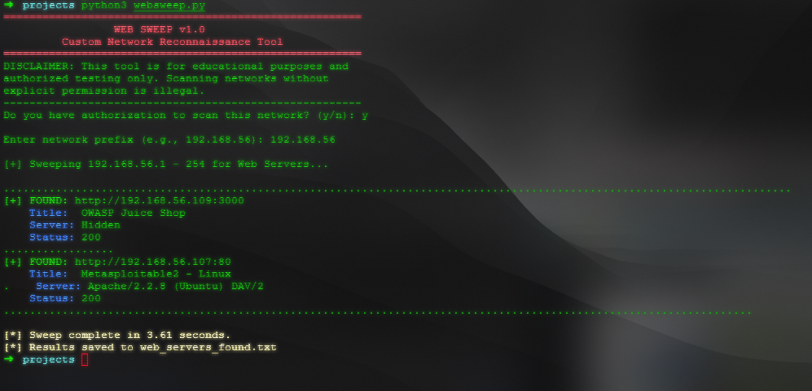

# WebSweep - Custom Network Reconnaissance Tool

## Description
WebSweep is a custom Python-based network scanner designed to sweep a /24 subnet, identify open web ports, and extract HTTP server banners and HTML titles. Built from scratch for authorized penetration testing and educational purposes.

## Features
* **Multithreaded:** Uses `ThreadPoolExecutor` with 250 workers for lightning-fast sweeps.
* **Stealth:** Injects a standard Windows Chrome `User-Agent` to bypass basic firewall blocks.
* **Deep Recon:** Extracts the HTML `<title>` and the `Server` header (e.g., Apache, Nginx).
* **Logging:** Saves all discovered web servers to a `web_servers_found.txt` file.

## Disclaimer
This tool is provided for educational purposes and authorized security testing only. Do not use this tool against networks you do not own or have explicit permission to test. The author is not responsible for any misuse or damage caused by this program.
